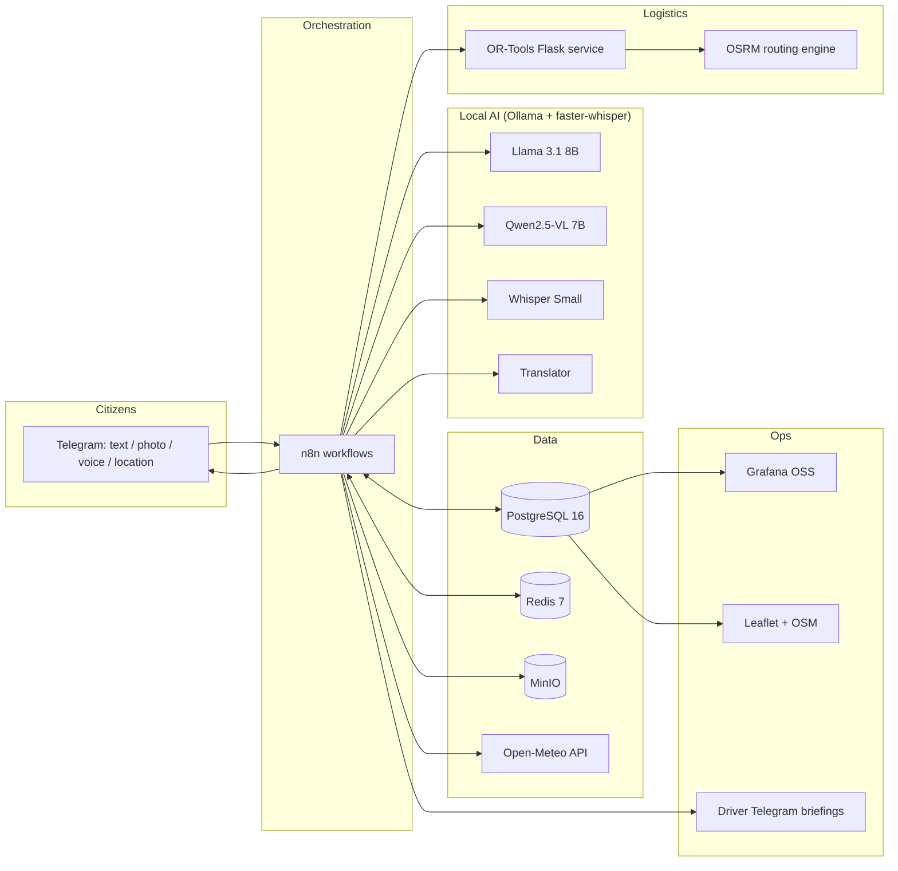

<div align="center">

# KachraGrid

### AI-powered municipal waste logistics for Indian cities.
### Open-source. Local-first. Free forever.


*Collect what is full. Skip what is not. Hear every citizen.*

</div>

---

## Table of Contents

1. [The Problem](#the-problem)
2. [The Solution](#the-solution)
3. [Pilot Results (Demo Scenario)](#pilot-results-demo-scenario)
4. [Features](#features)
5. [Architecture](#architecture)
6. [Tech Stack](#tech-stack)
7. [Quickstart](#quickstart)
8. [Configuration](#configuration)
9. [The Four Workflows](#the-four-workflows)
10. [AI Models and Prompts](#ai-models-and-prompts)
11. [Services and APIs](#services-and-apis)
12. [Database](#database)
13. [Dashboard](#dashboard)
14. [Evaluation Harness](#evaluation-harness)
15. [Agent Skill](#agent-skill)
16. [Repository Layout](#repository-layout)
17. [Hardware Requirements](#hardware-requirements)
18. [Roadmap](#roadmap)
19. [Contributing](#contributing)
20. [License](#license)

---

## The Problem

Most Indian municipal garbage collection runs on **fixed routes and fixed schedules**:

- Trucks stop at bins that are 20% full and skip bins that are 110% full.
- Overflowing bins near hospitals, markets and schools become public-health hazards.
- Citizen complaints arrive in Hindi, Kannada, English and Hinglish, with blurry photos and voice notes. Nobody triages them at scale.
- Missed pickups go unnoticed until a neighbourhood complains.
- Commercial route-optimization software is priced for enterprises, needs cloud APIs, and assumes reliable connectivity.

## The Solution

KachraGrid replaces the fixed schedule with a **closed loop**:

```
Sense  ->  Predict  ->  Optimize  ->  Dispatch  ->  Verify  ->  Learn
(photos,   (fill %     (OR-Tools +   (Hinglish     (anomaly    (history
 reports,   per bin)    OSRM routes)  Telegram       detection)  feeds
 weather)                             briefings)                 predictions)
```

Every component is free and open-source. All AI inference runs locally through Ollama. After initial setup, the system works without internet access.

---

## Pilot Results (Demo Scenario)

Pilot ward: **Ward 142, Jayanagar, Bangalore (BBMP)** with 25 bins, 3 trucks, 3 drivers.

Comparison for Truck T01 on a Monday, from the bundled sample dataset:

| Metric | Fixed route (old) | KachraGrid (optimized) | Change |
|---|---|---|---|
| Stops | 8 bins | 5 bins | -3 stops |
| Distance | 18.5 km | 11.2 km | **-39%** |
| Time | 3.5 h | 2.1 h | **-1.4 h** |
| Fuel | 6.2 L | 3.8 L | **-39%** |
| Wasted stops (bin under 30% full) | 1 (B002 at 20%) | 0 | eliminated |
| Overflowing bins skipped | 1 (B012 at 110%) | 0 | eliminated |

```
Fixed:     Depot > B001 > B002 > B003 > B004 > B005 > B006 > B007 > B008 > Depot
Optimized: Depot > B001 (95%) > B005 (100%) > B012 (110%) > B010 (88%) > B016 (82%) > Depot
```

> These figures come from the bundled demo dataset and a single-route comparison. They illustrate the method. They are not field measurements. Validate against your own city's data using the [evaluation harness](#evaluation-harness) before making operational claims.

---

## Features

**Citizen intake**
- Telegram bot accepts text, photos, voice notes and location pins.
- Voice notes are transcribed locally (Whisper Small via faster-whisper).
- Auto-detects language (Hindi, Kannada, English, Hinglish) and translates for processing.
- Qwen2.5-VL analyses bin photos: overflow level, waste type, fire, sharps, rubble, damage.
- Reports are classified (overflow, fire, hazardous, missed pickup, damage, illegal dump) and scored by severity.
- Citizens get a reply in their own language.

**Fill-level prediction**
- SQL baseline from collection history (`fn_estimate_fill_pct`).
- Llama 3.1 refines the estimate using area type, weather (rain increases wet-waste weight), day pattern and open citizen reports.
- Predictions are stored and scored against actual pickups.

**Route optimization**
- OR-Tools capacity-constrained routing with optional drops (low-priority bins can be skipped).
- OSRM provides real road distances for Bangalore.
- Hospital, market and slum bins get priority weighting. Fire and hazardous reports preempt the plan.
- Drivers receive a short Hinglish briefing on Telegram.

**Anomaly detection**
- Missed pickups, chronic overflow, hazardous-waste streams, sudden fill spikes, clustered reports.
- Alerts routed to supervisors via Telegram.

**Operations**
- Grafana dashboard: live fill heatmap, KPIs, open alerts, fixed-vs-optimized comparison.
- Leaflet + OpenStreetMap live bin map.
- MinIO stores photos and voice notes on your own hardware.

---

## Architecture



**Data flow summary**

| Trigger | Path |
|---|---|
| Citizen message | Telegram > n8n > (Whisper) > Translator > (Qwen-VL) > Llama > PostgreSQL > Telegram reply |
| Every 30 min | n8n > Open-Meteo + history > Llama > `fill_predictions` + `bins.current_fill_pct` |
| 05:00 daily | n8n > bins above threshold > OR-Tools + OSRM > Llama (Hinglish) > driver Telegram |
| Hourly | n8n > SQL anomaly rules > Llama > `anomalies` > supervisor Telegram |

---

## Tech Stack

| Layer | Tool | Why |
|---|---|---|
| Orchestration | n8n (self-hosted) | Visual, versionable JSON workflows |
| LLM | Llama 3.1 8B via Ollama | Multilingual reasoning, local |
| Vision | Qwen2.5-VL 7B via Ollama | Photo understanding, local |
| Speech-to-text | Whisper Small via faster-whisper | Hindi/Kannada/English, CPU-capable |
| Database | PostgreSQL 16 | Relational core, JSONB for AI output |
| Cache | Redis 7 | Dedup, rate limits, workflow state |
| Routing | OSRM + OR-Tools (Flask) | Real road distances, CVRP solver |
| Maps | OpenStreetMap + Leaflet.js | No API key, no billing |
| Dashboard | Grafana OSS | Provisioned from code |
| Messaging | Telegram Bot API | Free, works on low-end phones |
| Storage | MinIO | Self-hosted S3 |
| Weather | Open-Meteo | Free, no key |
| Packaging | Docker Compose | One command bring-up |
| Hosting | Local laptop or Oracle Cloud Always Free | Zero hosting cost |

The only credential required is a **Telegram bot token** from [@BotFather](https://t.me/BotFather).

---

## Quickstart

### Prerequisites

- Docker and Docker Compose v2
- 16 GB RAM minimum (see [Hardware Requirements](#hardware-requirements))
- 40 GB free disk
- A Telegram bot token

### 1. Clone and configure

```bash
git clone https://github.com/<your-org>/kachragrid.git
cd kachragrid
cp .env.example .env
# Edit .env and set TELEGRAM_BOT_TOKEN. Everything else has local defaults.
```

### 2. Prepare the OSRM road graph (one-time, needs internet)

```bash
# Downloads the Karnataka extract and builds the Bangalore routing graph
bash data/osrm/prepare-osrm.sh
```

### 3. Start the stack

```bash
docker compose up -d
```

PostgreSQL initializes itself from `database/init/` and loads the Ward 142 sample data automatically.

### 4. Pull the AI models (one-time, needs internet)

```bash
bash models/ollama/pull-models.sh
# Pulls: llama3.1:8b  and  qwen2.5vl:7b
```

### 5. Import the n8n workflows

Open `http://localhost:5678`, create the owner account, then import each file from `n8n/workflows/`:

```
01_citizen_report_intake.json
02_fill_prediction_cron.json
03_daily_route_optimizer.json
04_anomaly_detection.json
```

Create the Postgres, Redis, Telegram and MinIO credentials (templates in `n8n/credentials/credentials.example.json`), then activate all four workflows.

### 6. Open the interfaces

| Interface | URL | Default login |
|---|---|---|
| n8n | http://localhost:5678 | set at first launch |
| Grafana | http://localhost:3000 | from `.env` |
| MinIO console | http://localhost:9001 | from `.env` |
| Route optimizer API | http://localhost:5001/health | none |
| Leaflet map | `dashboard/leaflet/index.html` | none |

### 7. Verify

```bash
bash infra/scripts/healthcheck-all.sh
make test
make eval
```

### 8. Run the demo

Follow [`docs/demo-script.md`](docs/demo-script.md) for the 3-minute walkthrough.

---

## Configuration

All configuration lives in `.env`. Key variables:

| Variable | Purpose | Default |
|---|---|---|
| `TELEGRAM_BOT_TOKEN` | Bot credential from @BotFather | (required) |
| `OLLAMA_BASE_URL` | Ollama endpoint | `http://ollama:11434` |
| `LLM_MODEL` | Text model | `llama3.1:8b` |
| `VLM_MODEL` | Vision model | `qwen2.5vl:7b` |
| `POSTGRES_USER` / `POSTGRES_PASSWORD` / `POSTGRES_DB` | Database credentials | local dev values |
| `REDIS_URL` | Redis endpoint | `redis://redis:6379/0` |
| `OSRM_URL` | OSRM endpoint | `http://osrm:5000` |
| `OPEN_METEO_URL` | Weather API | `https://api.open-meteo.com/v1/forecast` |
| `PILOT_WARD_ID` | Ward to operate on | `142` |
| `FILL_THRESHOLD_PCT` | Minimum fill for routing | `70` |

---

## The Four Workflows

| # | Workflow | Trigger | What it does |
|---|---|---|---|
| 01 | **Citizen Report Intake** | Telegram webhook | Transcribe voice, detect language, translate, analyse photo, classify, match nearest bin, store, reply in citizen's language |
| 02 | **Fill Prediction** | Cron, every 30 min | Pull weather, compute baseline fill, refine with Llama, update `bins.current_fill_pct` |
| 03 | **Daily Route Optimizer** | Cron, 05:00 | Select bins above threshold plus priority overrides, call OR-Tools, generate Hinglish briefing, send to drivers |
| 04 | **Anomaly Detection** | Cron, hourly | Detect missed pickups, chronic overflow, hazardous streams, report clusters, alert supervisors |

Each workflow includes error-handling branches that log failures to the `anomalies` table and notify the supervisor chat.

---

## AI Models and Prompts

Prompt templates live in `models/prompts/`. Each has a `SYSTEM` and `USER` section and includes sample inputs from the Ward 142 dataset.

| Prompt | Model | Purpose |
|---|---|---|
| `bin_photo_analysis.md` | Qwen2.5-VL 7B | Structured JSON: fill level, waste type, hazards, damage |
| `fill_level_prediction.md` | Llama 3.1 8B | Refined fill forecast with confidence and reasoning |
| `route_summary_hinglish.md` | Llama 3.1 8B | Driver-friendly Hinglish route briefing |
| `citizen_chat_response.md` | Llama 3.1 8B | Multilingual acknowledgement and status reply |
| `anomaly_detection.md` | Llama 3.1 8B | Explain and classify flagged patterns |

All model calls use Ollama's `/api/generate` or `/api/chat` with `format: "json"` where structured output is required, and low temperature for reproducibility.

---

## Services and APIs

### Route Optimizer (`services/route-optimizer`, port 5001)

`POST /optimize`

```json
{
  "date": "2025-01-13",
  "min_fill_pct": 70,
  "bins": [
    {"bin_id": "B001", "lat": 12.9250, "lng": 77.5830, "fill_pct": 95, "capacity_kg": 1000, "priority": 1}
  ],
  "trucks": [
    {"truck_id": "T01", "capacity_kg": 8000, "depot_lat": 12.9250, "depot_lng": 77.5830}
  ]
}
```

Returns ordered stops per truck with distance (km), duration (h), and estimated fuel (L).

### Voice Processor (`services/voice-processor`, port 5002)

`POST /transcribe` with multipart audio. Returns `{ "text": "...", "language": "hi", "confidence": 0.93 }`.

### Translator (`services/translator`, port 5003)

`POST /translate` with `{ "text": "...", "source_lang": "hi", "target_lang": "en" }`. Returns `{ "translated_text": "..." }`. Runs offline with Argos Translate.

---

## Database

PostgreSQL 16 schema, indexes, seed data, functions and views are in `database/init/`.

| Table | Purpose |
|---|---|
| `wards`, `bins`, `trucks`, `drivers` | Master data |
| `collections` | Pickup history, including missed pickups |
| `citizen_reports` | Enriched reports with AI analysis in JSONB |
| `weather_daily` | Open-Meteo snapshots |
| `fill_predictions` | Every prediction, for later scoring |
| `routes`, `route_stops` | Planned fixed and optimized routes |
| `anomalies` | Detected issues and their resolution state |

Key objects:

- `fn_estimate_fill_pct(bin_id, at)` : baseline fill estimate from history and weather
- `v_bin_status_live` : Grafana source view with fill, priority and open-report counts
- `v_route_comparison` : fixed vs optimized savings

---

## Dashboard

Grafana is provisioned entirely from code (`dashboard/grafana/provisioning`).

- **Overview**: fill heatmap on OpenStreetMap, bins above 70%, overflow count, open anomalies, reports by category
- **Route comparison**: distance, time and fuel for fixed vs optimized, per truck, per day

The standalone Leaflet map (`dashboard/leaflet/`) colours each bin by fill level and links reports to bins.

---

## Evaluation Harness

Because all models are local and swappable, measuring them matters.

```bash
make eval
```

| Suite | Metric | Source |
|---|---|---|
| Fill prediction | MAE (percentage points), within-10pt accuracy | `eval/cases/fill_prediction_cases.json` |
| Photo analysis | Category accuracy, severity F1, hazard recall | `eval/cases/photo_analysis_cases.json` |
| Route savings | Distance, time, fuel savings vs fixed route | `eval/cases/route_savings_cases.json` |
| Model comparison | Llama vs Phi vs Qwen on the same cases | `eval/benchmarks/model_comparison_template.md` |

The scoring rubric is in `eval/harness/scoring_rubric.md`. Results are written to `eval/results/`.

---

## Agent Skill

KachraGrid exposes its analysis as a reusable agent skill: **`waste-bin-analyzer`**.

- Manifest: `skills/waste-bin-analyzer/skill.json`
- Input: bin photo and/or text report, optional location
- Output: waste type, fill estimate, hazards, severity, recommended action
- Examples: `skills/waste-bin-analyzer/examples/`

Any agent framework that supports the skill manifest format can call it.

---

## Repository Layout

```text
kachragrid/
├── docker-compose.yml     # Entire stack
├── .env.example           # All configuration
├── database/init/         # Schema, seed data, functions, views
├── n8n/workflows/         # 4 importable workflow JSON files
├── models/                # Ollama setup + prompt templates
├── services/              # route-optimizer, voice-processor, translator
├── dashboard/             # Grafana provisioning + Leaflet map
├── skills/                # waste-bin-analyzer manifest
├── data/                  # Sample CSVs, demo images, OSRM prep
├── infra/                 # MinIO, Redis, Postgres config, scripts
├── eval/                  # Evaluation harness
├── tests/                 # Integration and end-to-end tests
└── docs/                  # Architecture, deployment, demo script
```

Full file-by-file listing: [`PART1_STRUCTURE.md`](PART1_STRUCTURE.md).

---

## Hardware Requirements

| Setup | RAM | GPU | Notes |
|---|---|---|---|
| Laptop (recommended for demo) | 16 GB+ | 8 GB VRAM or better | Llama 3.1 8B and Qwen2.5-VL 7B respond in seconds |
| Laptop, CPU only | 16 GB+ | none | Works. Photo analysis takes tens of seconds per image |
| Oracle Cloud Always Free (ARM) | 24 GB | none | Works for batch workflows (routes, predictions). Interactive photo analysis is slow |

Workflows are designed to tolerate latency: citizen replies are asynchronous, and routing runs before the shift starts. Models are loaded on demand and unloaded when idle to fit in memory.

---

## Roadmap

- [x] Ward 142 pilot: 25 bins, 3 trucks
- [ ] Scale to 500 bins across multiple wards
- [ ] Kannada voice and text hardening
- [ ] WhatsApp channel via self-hosted bridge
- [ ] Driver mobile web app with turn-by-turn navigation
- [ ] Bin IoT fill sensors as an optional input (ultrasonic, LoRa)
- [ ] Waste-segregation analytics per ward
- [ ] Reinforcement of predictions from verified pickup weights
- [ ] Multi-city configuration (Hyderabad, Pune, Chennai)

---

## Contributing

Contributions are welcome, especially from municipal workers, sanitation engineers and civic-tech practitioners.

1. Fork the repository and create a feature branch.
2. Run `make test` and `make eval` before opening a pull request.
3. Keep every dependency free and open-source. No proprietary APIs.
4. Document new environment variables in `.env.example` and this README.

Good first issues: new prompt languages, additional ward datasets, Grafana panels, OSRM profile tuning for Indian road conditions.

---

## Data and Privacy

- Citizen phone numbers are stored masked.
- Photos and voice notes remain on your own MinIO instance.
- No data leaves your infrastructure except Telegram messages and Open-Meteo weather queries.
- The sample dataset is synthetic. Bin coordinates approximate Jayanagar and do not represent real BBMP assets.

---

## License

Released under the **GNU AGPL-3.0**. Free to use, modify and deploy. Modified network-served versions must publish their source.

---

<div align="center">

**KachraGrid** : built so every bin gets emptied when it needs to be, and every citizen gets heard.

</div>
